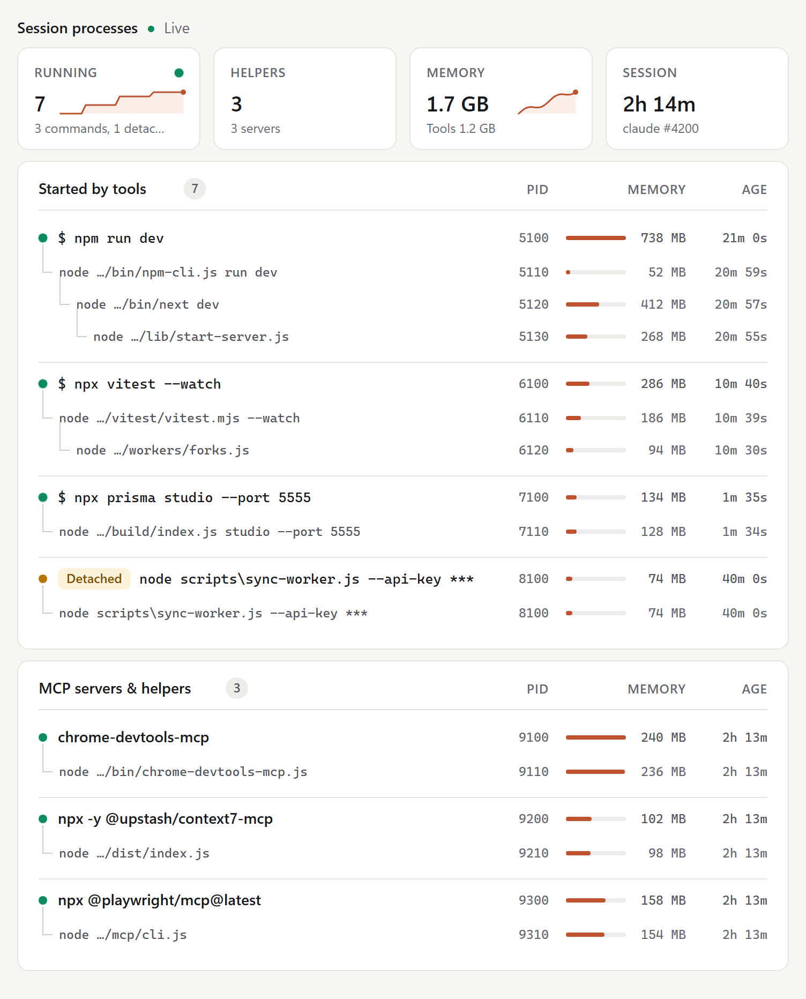
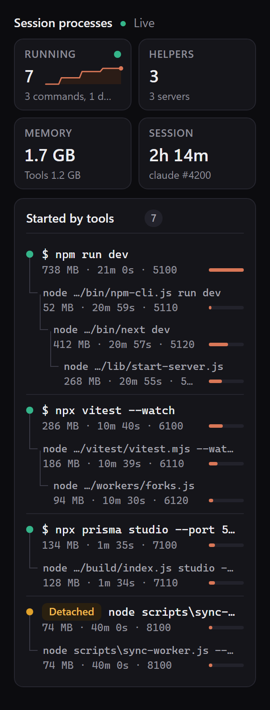
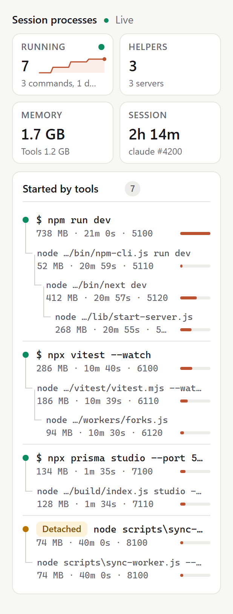

# claude-mods

**Open-source mods for [Claude Code](https://claude.com/claude-code).** Mods are small plugins that change Claude Code's own interface: a live pane beside the transcript, a line in the status bar, a slash command, a hook on tool calls. They use Claude Code's function-hooks API and install with one command.

Every mod here runs locally, makes no network calls, and sends nothing to the model. Each mod's README says exactly what it runs and what it reads.

<picture>
  <source media="(prefers-color-scheme: dark)" srcset="docs/screenshots/wide-dark.png">
  
</picture>

## Mods

| Mod | What it does |
| --- | --- |
| [**session-procs**](mods/session-procs) | A live pane that lists every process your Claude Code session started: dev servers launched from Bash, the tool shells running them, and the session's MCP servers. It shows memory, uptime and sparklines, flags processes left running after their shell exited, and masks secrets in command lines. |

## session-procs at a glance

Ask Claude to start a dev server, a test watcher or a database studio, and they stay visible in a pane docked beside the session sidebar. You never have to hunt for a stray `node` process again.

<p>
  
  &nbsp;
  
</p>

- **Started by tools.** Each command Claude ran, titled with the command itself (`$ npm run dev`), with the processes under it as a tree.
- **Detached.** Processes that kept running after the shell that started them exited, so orphans don't go unnoticed.
- **MCP servers and helpers.** The session's MCP servers, one entry per server, behind a toggle.
- **Stat tiles.** Running processes, helpers, total memory and session uptime, with sparklines.
- **Memory meters.** Turn amber above 1 GB and red above 2 GB.
- **Secret masking.** Tokens, passwords, API keys, credential headers and URL passwords are masked before anything is drawn.
- **Fits your setup.** Follows your light or dark theme on the desktop app. Draws a themed text view in the terminal. Works on Windows, macOS and Linux.

The screenshots use demo data.

## Install

At the prompt of a Claude Code terminal session:

```
/plugin install session-procs --marketplace iftahs/claude-mods
```

Answer `y` to add the marketplace, then pick a scope. User scope loads the mod in every session, desktop app sessions included. To remove it later, run `/plugin uninstall session-procs`.

Mods use Claude Code's function-hooks API, which is in early access and changes between releases. Each mod's README names the version it was tested on.

## Try a mod from a clone

```bash
git clone https://github.com/iftahs/claude-mods.git
claude --plugin-dir claude-mods/mods/session-procs
```

To load it in every session without installing, add the folder to `CLAUDE_CODE_PLUGIN_DIRS` in the `env` block of `~/.claude/settings.json`.

## Contributing

Pull requests are welcome, from fixes to brand-new mods. See [CONTRIBUTING.md](CONTRIBUTING.md). Every change goes through a pull request and is reviewed by the maintainer before it is merged.

## Security

Found a security problem? Please report it privately, as described in [SECURITY.md](SECURITY.md), not in a public issue.

## Author

Made by **Iftah Saar**, full-stack developer. More at **[iftah.dev](https://iftah.dev)**.

## License

[MIT](LICENSE)
